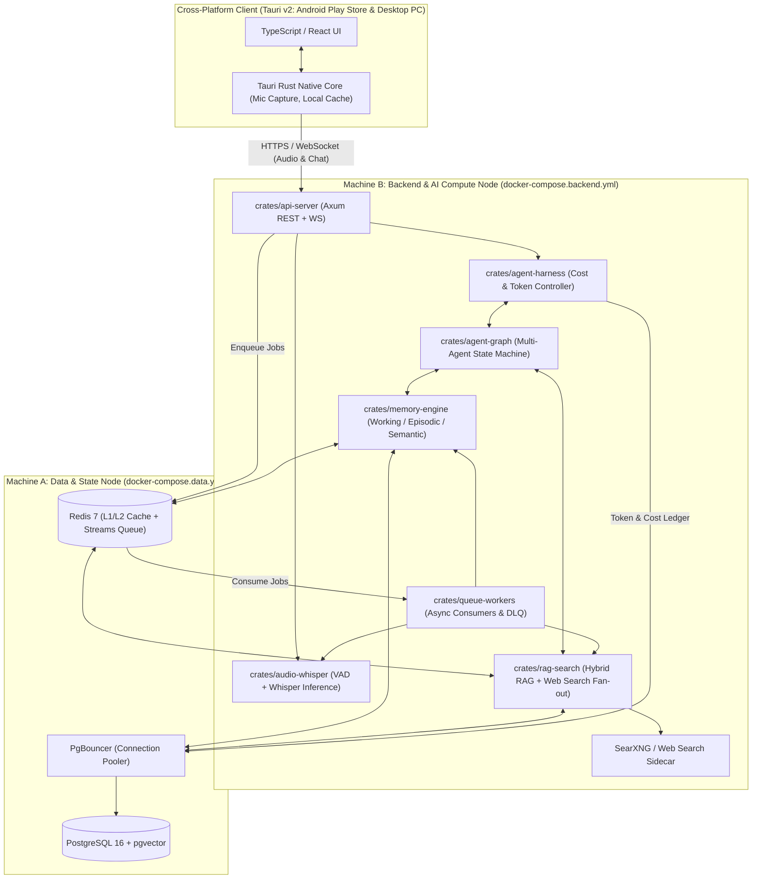
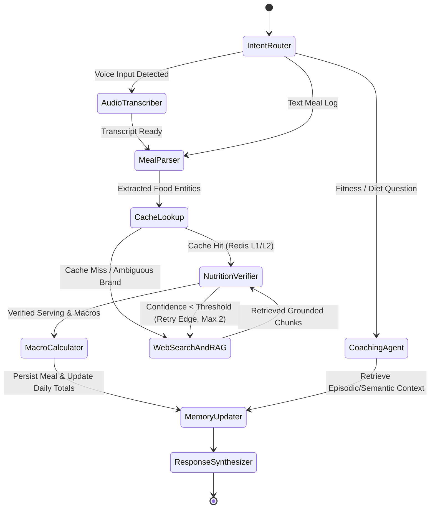
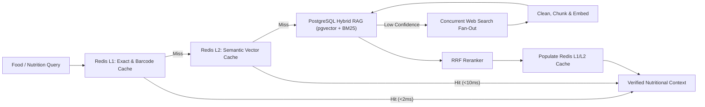
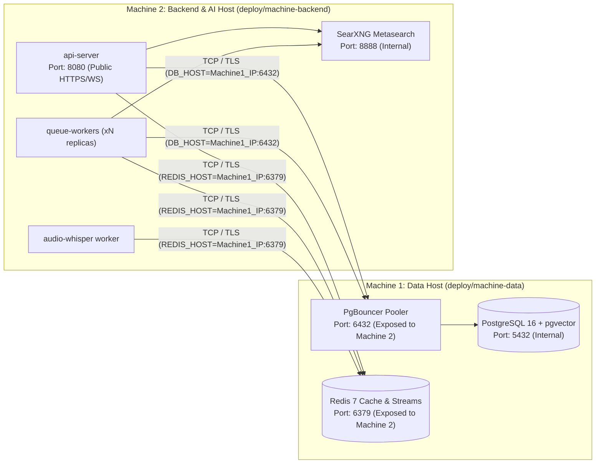

# Calorie-Counter AI — Multi-Agent Fitness & Nutrition Platform

An open-source, cross-platform (**Android Play Store & Desktop PC**) AI fitness and calorie-counting application powered by a **Rust** backend, **TypeScript + Tauri v2** frontend, **Whisper** audio transcription, a cost-controlled **Multi-Agent Graph Engine**, **Redis-cached RAG & Massive Web Search pipelines**, and **PostgreSQL (`pgvector`)**.

> **Status:** Architectural Scaffold & System Design Plan (No implementation code yet).

---

## Table of Contents

1. [Core Architectural Pillars](#1-core-architectural-pillars)
2. [Tech Stack Selection](#2-tech-stack-selection)
3. [Repository Directory Scaffold](#3-repository-directory-scaffold)
4. [System Architecture & Data Flow](#4-system-architecture--data-flow)
5. [Agent Graph & Cost/Token Control Harness](#5-agent-graph--costtoken-control-harness)
6. [Whisper Audio Transcription Pipeline (Rust)](#6-whisper-audio-transcription-pipeline-rust)
7. [Solid Queues & Multi-Tier Conversation Memory](#7-solid-queues--multi-tier-conversation-memory)
8. [Massive Web Search, Hybrid RAG & Redis Caching](#8-massive-web-search-hybrid-rag--redis-caching)
9. [PostgreSQL Database & `pgvector` Schema Plan](#9-postgresql-database--pgvector-schema-plan)
10. [Cross-Platform Client (Play Store & Desktop PC)](#10-cross-platform-client-play-store--desktop-pc)
11. [Multi-Machine Docker Compose Deployment Topology](#11-multi-machine-docker-compose-deployment-topology)
12. [Implementation Roadmap](#12-implementation-roadmap)

---

## 1. Core Architectural Pillars

1. **Stateful Multi-Agent Graph with Cost & Token Harness (`crates/agent-graph` + `crates/agent-harness`)**
   - Directed cyclic/acyclic execution graph where specialized agents (Intent Router, Meal Extractor, Nutrition Verifier, Web Researcher, Fitness Coach) collaborate.
   - Wrapped in a strict **Execution Harness** enforcing token budgets, per-user/per-turn USD spending caps, dynamic model tier routing (small/fast models vs. deep reasoning models), loop detection, and circuit breaking.
2. **Rust Whisper Audio Transcription (`crates/audio-whisper`)**
   - Native Rust audio ingestion using Voice Activity Detection (VAD), PCM normalization, and Whisper inference (`whisper-rs` / `candle` / `ort`) for hands-free voice meal logging (*"I just ate 200g of grilled chicken breast with a tablespoon of olive oil and a medium sweet potato"*).
3. **Resilient Queues & Multi-Tier Conversation Memory (`crates/queue-workers` + `crates/memory-engine`)**
   - Asynchronous job processing via Redis Streams / transactional outbox with Dead-Letter Queues (DLQ), exponential backoff, and backpressure control.
   - Three-tier memory architecture across conversations: **Working Memory** (Redis sliding window + token-aware context pruning), **Episodic Memory** (PostgreSQL + `pgvector` past conversations & meal logs), and **Semantic Memory** (consolidated user profile, allergies, TDEE/BMR, macro targets, and habits).
4. **Massive Web Search & RAG Pipeline with Multi-Layer Redis Caching (`crates/rag-search`)**
   - High-concurrency web search fan-out (SearXNG / Tavily / Brave / nutritional databases like USDA & OpenFoodFacts) paired with a Hybrid RAG pipeline (dense `pgvector` embeddings + sparse BM25 + Reciprocal Rank Fusion reranking).
   - **Redis L1/L2 caching** for hot food items, barcode lookups, pre-computed macro breakdowns, and semantic query caching to eliminate redundant LLM and search calls.
5. **Rust Backend + TypeScript/Tauri v2 Cross-Platform Frontend (`crates/*` + `apps/client`)**
   - Single codebase targeting **Google Play Store (Android)** and **Desktop PC (Linux, Windows, macOS)** using **Tauri v2** (Rust native core + TypeScript/React UI).
6. **Multi-Machine Docker Compose Topology (`deploy/`)**
   - First-class separation between **Machine A (Data Node: PostgreSQL + `pgvector`, PgBouncer, Redis)** and **Machine B (Compute Node: Rust API Server, Queue Workers, Whisper Worker, Search Sidecars)**, plus a unified `docker-compose.full.yml` for single-machine local testing.

---

## 2. Tech Stack Selection

| Layer | Technology | Rationale |
| :--- | :--- | :--- |
| **Desktop & Mobile App** | **Tauri v2** + **TypeScript (React + Vite)** | Native Rust bridge for Android (Play Store APK/AAB) and Desktop PC (Windows/macOS/Linux) with minimal binary size and native audio recording access. |
| **Backend API Gateway** | **Rust (`axum`, `tokio`, `tower-http`)** | High-throughput async HTTP/REST + WebSocket streaming for real-time agent token & audio transcription updates. |
| **Agent Graph & Harness** | **Rust (`petgraph`, `tiktoken-rs`, `async-openai`)** | Type-safe DAG/state-machine orchestration with deterministic token counting and hard budget enforcement before & during LLM streams. |
| **Audio Transcription** | **Rust (`whisper-rs` / `candle`, `symphonia`, `rubato`, `webrtc-vad`)** | Zero-Python dependency audio decoding, 16kHz mono resampling, silence stripping, and local/worker Whisper inference. |
| **Primary Database** | **PostgreSQL 16 + `pgvector` + `sqlx`** | ACID relational storage for users, meals, and token ledgers, plus HNSW vector indexing for RAG and episodic memory. |
| **Cache & Message Broker** | **Redis 7 (Redis Streams + Cache)** | Sub-millisecond caching for hot nutrition facts/semantic RAG hits and consumer-group durable queues for background workers. |
| **Container Orchestration** | **Docker & Docker Compose (Multi-Host)** | Isolated `machine-data` and `machine-backend` compose stacks communicating over encrypted overlay/VPC networks or WireGuard/TLS. |

---

## 3. Repository Directory Scaffold

```text
calorie-counter/
├── Cargo.toml                                  # Rust Workspace root definition
├── README.md                                   # System architecture & implementation plan
├── LICENSE
├── .gitignore
│
├── apps/
│   └── client/                                 # Cross-platform Frontend (Play Store + Desktop PC)
│       ├── package.json                        # TypeScript / React / Vite dependencies
│       ├── tsconfig.json                       # TypeScript configuration
│       ├── vite.config.ts                      # Vite bundler configuration
│       ├── src/                                # TypeScript UI Layer
│       │   ├── main.tsx                        # React entry point
│       │   ├── App.tsx                         # Root layout & router
│       │   ├── components/                     # Shared UI widgets (MacroRings, TokenMeter, AudioWave)
│       │   ├── features/
│       │   │   ├── audio-recorder/             # Voice meal logging UI & streaming waveform
│       │   │   ├── chat/                       # Multi-agent coaching conversation interface
│       │   │   ├── dashboard/                  # Daily calories, macros, TDEE & streaks
│       │   │   ├── meal-log/                   # Structured food diary & barcode/search entry
│       │   │   └── profile/                    # Biometrics, goals, dietary restrictions
│       │   ├── hooks/                          # React hooks (useAudioStream, useAgentSocket)
│       │   ├── lib/                            # API client, Tauri IPC wrappers
│       │   ├── services/                       # Offline sync & background upload managers
│       │   ├── store/                          # State management (Zustand / TanStack Query)
│       │   └── types/                          # TypeScript interfaces mirroring shared-types
│       └── src-tauri/                          # Tauri v2 Rust Core (Mobile Android + Desktop PC)
│           ├── Cargo.toml                      # Tauri native dependencies
│           ├── tauri.conf.json                 # App identifiers, Play Store & Desktop bundle config
│           ├── capabilities/                   # Microphone, network & filesystem permissions
│           ├── gen/android/                    # Generated Android Studio / Gradle project for Play Store
│           ├── icons/                          # Adaptive icons for Android & Desktop
│           └── src/
│               ├── main.rs                     # Desktop binary entry point
│               ├── lib.rs                      # Mobile (Android JNI) & shared entry point
│               ├── audio/                      # Native microphone capture & PCM chunk ringbuffer
│               ├── commands/                   # Tauri #[tauri::command] IPC handlers
│               └── storage/                    # Local SQLite/encrypted keychain for offline caching
│
├── crates/                                     # Backend Rust Workspace Crates
│   ├── api-server/                             # HTTP REST + WebSocket API Gateway
│   │   ├── Cargo.toml
│   │   └── src/
│   │       ├── main.rs                         # Server bootstrap & graceful shutdown
│   │       ├── lib.rs                          # AppState & router assembly
│   │       ├── handlers/                       # Auth, Chat, Audio upload, Meal CRUD endpoints
│   │       ├── middleware/                     # JWT auth, rate-limiting, harness budget pre-check
│   │       ├── routes/                         # API v1 route definitions
│   │       └── ws/                             # Bi-directional WebSocket for live audio & agent events
│   │
│   ├── agent-graph/                            # Complex Multi-Agent State Machine & Graph Engine
│   │   ├── Cargo.toml
│   │   └── src/
│   │       ├── lib.rs                          # Graph executor & checkpoint interface
│   │       ├── state/                          # Immutable/versioned GraphState passed across nodes
│   │       ├── nodes/                          # Specialized Agent Nodes:
│   │       │                                   #   - intent_router.rs
│   │       │                                   #   - meal_parser.rs
│   │       │                                   #   - nutrition_lookup.rs
│   │       │                                   #   - web_researcher.rs
│   │       │                                   #   - fitness_coach.rs
│   │       │                                   #   - critic_verifier.rs
│   │       ├── edges/                          # Conditional routing & cyclic retry predicates
│   │       └── workflows/                      # Pre-built DAG/cyclic graphs (MealLogFlow, CoachingFlow)
│   │
│   ├── agent-harness/                          # Cost, Token & Reliability Control Harness
│   │   ├── Cargo.toml
│   │   └── src/
│   │       ├── lib.rs                          # Harness interceptor wrapping every graph node call
│   │       ├── budget/                         # Per-request, per-conversation & daily user token/USD caps
│   │       ├── tokenizer/                      # Fast BPE token pre-calculation & context window guard
│   │       ├── routing/                        # Dynamic Model Tier Router (Small/Fast vs Reasoning LLM)
│   │       ├── pricing/                        # Model price catalog (input/output/cached token rates)
│   │       ├── circuit_breaker/                # Max-iteration guards, loop detection & provider failover
│   │       ├── policies/                       # Degradation policies (e.g., fallback to cache-only mode)
│   │       └── metrics/                        # OpenTelemetry token/cost counters & latency histograms
│   │
│   ├── audio-whisper/                          # Rust Whisper Audio Transcription Engine
│   │   ├── Cargo.toml
│   │   └── src/
│   │       ├── lib.rs                          # Transcription service facade
│   │       ├── preprocessors/                  # Format decoding (Opus/AAC/WAV -> 16kHz Mono f32 PCM)
│   │       ├── vad/                            # Voice Activity Detection to strip silence (saves compute)
│   │       ├── chunker/                        # Overlapping sliding-window audio segmentation
│   │       ├── models/                         # Whisper model loader (quantized ggml/onnx weights)
│   │       └── pipeline/                       # Streaming & batch transcription with food-domain prompt bias
│   │
│   ├── memory-engine/                          # Multi-Tier Conversation & User Memory System
│   │   ├── Cargo.toml
│   │   └── src/
│   │       ├── lib.rs                          # Unified MemoryManager interface
│   │       ├── working/                        # Redis-backed active turn buffer & token-aware window trimmer
│   │       ├── episodic/                       # Vectorized past conversation turns & historical meal events
│   │       ├── semantic/                       # Long-term structured user facts (allergies, preferences, TDEE)
│   │       ├── summarizer/                     # Background recursive conversation compaction
│   │       └── consolidation/                  # Async worker logic extracting semantic facts from episodes
│   │
│   ├── queue-workers/                          # Distributed Queue Producers, Consumers & Job Orchestration
│   │   ├── Cargo.toml
│   │   └── src/
│   │       ├── lib.rs                          # Queue worker runtime
│   │       ├── producers/                      # Enqueue helpers with idempotency keys
│   │       ├── consumers/                      # Worker pools (AudioJob, RagIngestJob, MemoryConsolidateJob)
│   │       ├── jobs/                           # Strongly-typed job payloads & retry policies
│   │       ├── dlq/                            # Dead-Letter Queue inspection, alerting & replay
│   │       └── scheduler/                      # Cron/periodic tasks (daily macro rollups, cache warming)
│   │
│   ├── rag-search/                             # Massive Web Search, Hybrid RAG & Redis Cache Engine
│   │   ├── Cargo.toml
│   │   └── src/
│   │       ├── lib.rs                          # Unified SearchAndRetrieve pipeline
│   │       ├── cache/                          # Multi-layer Redis cache (Exact key, Barcode, Semantic vector)
│   │       ├── web_search/                     # Concurrent search fan-out (SearXNG, USDA, OpenFoodFacts, Web)
│   │       ├── ingestion/                      # HTML cleaner, nutrition table parser & markdown extractor
│   │       ├── chunking/                       # Semantic & structural document chunking
│   │       ├── embeddings/                     # Local/API embedding generator with batching
│   │       ├── retriever/                      # Hybrid PostgreSQL retriever (pgvector HNSW + BM25 tsvector)
│   │       └── reranker/                       # Reciprocal Rank Fusion (RRF) & cross-encoder scoring
│   │
│   ├── db-postgres/                            # PostgreSQL Data Access Layer & Migrations
│   │   ├── Cargo.toml
│   │   ├── migrations/                         # SQLx sequential schema migrations
│   │   └── src/
│   │       ├── lib.rs                          # PgPool initialization & health checks
│   │       ├── models/                         # Database row structs
│   │       └── repositories/                   # Users, Meals, Conversations, TokenLedger, RagDocuments
│   │
│   └── shared-types/                           # Cross-Crate & Cross-Platform Domain Contracts
│       ├── Cargo.toml
│       └── src/
│           ├── lib.rs
│           ├── agent/                          # Graph events, citations, token usage DTOs
│           ├── audio/                          # Audio chunk frames, transcript segments
│           ├── events/                         # WebSocket & queue envelope schemas
│           ├── nutrition/                      # Macros, micronutrients, serving units, food items
│           └── user/                           # Biometrics, goals, metabolic profiles
│
├── deploy/                                     # Multi-Machine & Local Docker Compose Infrastructure
│   ├── docker-compose.full.yml                 # All-in-one local dev stack (simulates both machines)
│   ├── machine-data/                           # MACHINE 1: Stateful Data & Cache Host
│   │   └── docker-compose.data.yml             # PostgreSQL (pgvector), PgBouncer, Redis 7
│   ├── machine-backend/                        # MACHINE 2: Stateless Compute, AI & Worker Host
│   │   └── docker-compose.backend.yml          # API Server, Queue Workers, Whisper Worker, SearXNG
│   ├── dockerfiles/
│   │   ├── Dockerfile.api                      # Multi-stage Rust build for api-server
│   │   ├── Dockerfile.worker                   # Multi-stage Rust build for queue-workers
│   │   ├── Dockerfile.whisper                  # Whisper worker image (with optional CUDA/OpenBLAS)
│   │   └── Dockerfile.migrations               # Lightweight sqlx-cli migration runner
│   ├── env/
│   │   ├── .env.local.example                  # Environment template for local full stack
│   │   ├── .env.machine-data.example           # Environment template for Machine 1 (Database/Redis)
│   │   └── .env.machine-backend.example        # Environment template for Machine 2 (Backend/Workers)
│   ├── postgres/
│   │   ├── init-pgvector.sql                   # Enables vector, pg_trgm, uuid-ossp extensions
│   │   ├── postgresql.conf                     # Tuned memory, shared_buffers & HNSW build settings
│   │   └── pg_hba.conf                         # Strict host-based authentication for Machine 2 IP/subnet
│   └── redis/
│       └── redis.conf                          # AOF + RDB persistence for queues + LFU policy for cache
│
├── docs/                                       # Extended Engineering Documentation
│   ├── adr/                                    # Architecture Decision Records
│   ├── architecture/                           # Deep-dive sequence & state diagrams
│   └── runbooks/                               # Operations, DLQ recovery & DB failover guides
└── scripts/                                    # Dev automation, typegen & deployment scripts
```

---

## 4. System Architecture & Data Flow



---

## 5. Agent Graph & Cost/Token Control Harness

### 5.1 Complex Agent Graph (`crates/agent-graph`)
Instead of a single monolithic prompt, user requests execute as a stateful graph where transitions are governed by typed edges:



- **State Checkpointing**: Every node transition serializes a lightweight `GraphState` snapshot to Redis so interrupted sessions or rate-limited steps can resume without re-running completed nodes.

### 5.2 Cost & Token Control Harness (`crates/agent-harness`)
Every LLM or embedding invocation in `agent-graph` **must** pass through `AgentHarness::execute_node()`. Direct LLM SDK calls outside the harness are forbidden by workspace visibility rules.

1. **Pre-Flight Token Budgeting**:
   - Uses `tiktoken-rs` / fast local tokenizers to count prompt tokens *before* sending network requests.
   - Enforces three hierarchical budgets:
     - **Node Budget**: Max input/output tokens per individual node (e.g., `IntentRouter` capped at 150 output tokens).
     - **Run/Turn Budget**: Max total tokens and USD cost across all cyclic graph iterations for a single user message (e.g., max `$0.015` or `12,000` tokens per turn).
     - **User Daily Quota**: Tracked atomically in Redis + persisted to PostgreSQL `token_ledger` table.
2. **Dynamic Model Tier Routing**:
   - **Tier 0 (Deterministic / Local)**: Regex/heuristic parser, Redis exact/semantic cache hit, local embeddings (`0` LLM cost).
   - **Tier 1 (Fast/Nano LLM)**: Used for `IntentRouter`, `MealParser`, and query rewriting.
   - **Tier 2 (Reasoning LLM)**: Reserved strictly for complex metabolic coaching, multi-ingredient recipe decomposition, or conflicting nutritional source synthesis.
   - **Automatic Downgrade Policy**: When a user reaches 80% of their daily budget, the harness automatically downgrades Tier 2 calls to Tier 1 and disables deep multi-hop web expansion.
3. **Loop & Runaway Circuit Breakers**:
   - Hard `max_graph_steps` counter (default: `8` transitions).
   - Cycle hash detector: prevents an agent from issuing duplicate search queries in a loop.

---

## 6. Whisper Audio Transcription Pipeline (Rust)

Located in `crates/audio-whisper`, designed for zero-Python overhead and accuracy on food/fitness terminology:

1. **Client-Side Capture (`apps/client/src-tauri/src/audio`)**:
   - Captures raw microphone input on Android and Desktop, encoding into compact Opus/WebM frames or 16kHz PCM chunks streamed over WebSocket or uploaded as a batch voice note.
2. **Server-Side Decoding & VAD (`preprocessors/` + `vad/`)**:
   - `symphonia` decodes compressed mobile audio formats into raw PCM; `rubato` resamples to 16kHz mono `f32`.
   - **Voice Activity Detection (`webrtc-vad` / Silero ONNX)** strips leading, trailing, and mid-sentence silences before inference, cutting Whisper compute time by 30–60%.
3. **Domain-Prompted Whisper Inference (`models/` + `pipeline/`)**:
   - Runs quantized Whisper models (`whisper-rs` / `candle` / `ort`) initialized with an `initial_prompt` seeded with nutritional vocabulary (units like `g`, `oz`, `kcal`, `macros`, common brand names, and supplements) to drastically reduce spelling errors on food names.
   - Supports both synchronous fast-path (short voice notes < 15s) and queue-dispatched worker processing (longer voice logs or workout reflections).

---

## 7. Solid Queues & Multi-Tier Conversation Memory

### 7.1 Solid Distributed Queues (`crates/queue-workers`)
Built on **Redis Streams** (with consumer groups, `XREADGROUP`, `XACK`, and `XPENDING` recovery) combined with a **PostgreSQL Transactional Outbox** for critical state mutations:

- **Queue Topics**:
  - `queue:audio:transcribe` — High-priority audio processing jobs.
  - `queue:rag:ingest` — Web scraping, nutrition table extraction, chunking, and vector indexing.
  - `queue:memory:consolidate` — Post-conversation episodic summarization and semantic profile extraction.
  - `queue:analytics:rollup` — Daily/weekly TDEE adjustment and adherence recalculation.
- **Reliability Guarantees**:
  - **Idempotency Keys**: Every job carries a deterministic `job_id` hash to prevent duplicate meal logging or double token charging on retry.
  - **Exponential Backoff + Jitter**: Transient failures retry up to $N$ times before moving to `queue:dlq`.
  - **Backpressure & Rate Limiting**: Worker pools dynamically throttle concurrency if PostgreSQL connection pressure or upstream LLM rate limits are triggered.

### 7.2 Multi-Tier Conversation Memory (`crates/memory-engine`)
Solves context bloat while keeping long-term continuity across weeks/months of coaching:

| Memory Tier | Storage Engine | Retention & Scope | Purpose |
| :--- | :--- | :--- | :--- |
| **1. Working Memory** | **Redis** (`mem:work:{conv_id}`) | Active session (TTL 24h) | Holds the last $K$ raw turns plus a rolling compressed summary of earlier turns in the active conversation, strictly bounded by the Harness token budget (e.g., $\le 2,500$ tokens). |
| **2. Episodic Memory** | **PostgreSQL + `pgvector`** (`conversation_episodes`, `meal_logs`) | Permanent, per-user | Stores vector-embedded summaries of past conversations, specific meal events, and weekly check-ins. Retrieved via hybrid similarity + recency decay when relevant (*"What did I eat before my last long run?"*). |
| **3. Semantic Memory** | **PostgreSQL JSONB + Relational** (`user_semantic_facts`) | Permanent, continuously updated | Structured key-value and graph facts extracted asynchronously by `MemoryConsolidateJob`: allergies, disliked foods, metabolic baseline, habitual meal times, kitchen equipment, and current weight/macro targets. |

---

## 8. Massive Web Search, Hybrid RAG & Redis Caching

Located in `crates/rag-search`, engineered to handle thousands of food items, restaurant menus, and regional products with minimal latency:



### 8.1 Multi-Layer Redis Cache Strategy (`crates/rag-search/src/cache`)
1. **L1 Canonical & Barcode Cache (`cache:food:barcode:{ean}` / `cache:food:norm:{hash}`)**:
   - Stores verified macro/micronutrient profiles for common ingredients, USDA foundation foods, and OpenFoodFacts barcodes.
   - Configured with **LFU (Least Frequently Used)** eviction (`allkeys-lfu`) so the top 100,000 most logged foods stay permanently hot in RAM.
2. **L2 Semantic Query Cache (`cache:rag:semantic:{hash}`)**:
   - Normalizes and caches responses for near-identical natural language queries (e.g., *"calories in medium banana"* vs *"1 medium banana kcal"*) so neither web search nor LLM extraction runs twice.
3. **L3 Negative / Rate-Limit Cache**:
   - Caches domain cooldowns and unresolvable URLs to prevent hammering external sites during massive search fan-outs.

### 8.2 Massive Web Search & Hybrid RAG Pipeline
1. **Concurrent Search Fan-Out (`web_search/`)**:
   - Queries multiple sources in parallel using bounded `tokio::Semaphore` pools: self-hosted **SearXNG** metasearch, **USDA FoodData Central API**, **OpenFoodFacts**, and regional nutrition tables.
2. **Fast Rust Ingestion (`ingestion/` + `chunking/`)**:
   - Strips scripts/ads, extracts HTML `<table>` nutrition labels and JSON-LD recipe/nutrition schemas directly in Rust, and splits text into nutrition-aware semantic chunks.
3. **Hybrid Retrieval + RRF Reranking (`retriever/` + `reranker/`)**:
   - Combines **Dense Vector Search** (`pgvector` HNSW cosine similarity) with **Sparse Keyword Search** (PostgreSQL `tsvector` / BM25 for exact brand/product numbers) merged via **Reciprocal Rank Fusion (RRF)**.

---

## 9. PostgreSQL Database & `pgvector` Schema Plan

Managed in `crates/db-postgres/migrations/`:

1. **`users` & `user_biometrics`**:
   - User accounts, height, weight history, activity level, BMR/TDEE calculations, and daily calorie/macro targets (Protein, Carbs, Fat, Fiber, Water).
2. **`meals` & `meal_items`**:
   - Logged meals with timestamps, audio recording references, confidence scores, and per-ingredient macro/micronutrient breakdowns.
3. **`foods_catalog`**:
   - Canonical verified foods, serving sizes, barcodes, source citations, and embedding vectors (`vector(1536)` / `vector(768)`).
4. **`conversations`, `messages` & `conversation_episodes`**:
   - Full chat history, serialized graph checkpoints, and `pgvector`-indexed episodic summaries.
5. **`user_semantic_facts`**:
   - Versioned long-term user facts with confidence scores and source message foreign keys.
6. **`rag_documents` & `rag_chunks`**:
   - Scraped web pages, content hashes (for deduplication), `tsvector` full-text search index, and `pgvector` HNSW index.
7. **`token_ledger` & `cost_budgets`**:
   - Granular audit log of every agent node execution: `user_id`, `conversation_id`, `node_name`, `model_id`, `prompt_tokens`, `completion_tokens`, `cached_tokens`, `cost_usd_micros`, and `latency_ms`.

---

## 10. Cross-Platform Client (Play Store & Desktop PC)

Built in `apps/client` using **Tauri v2** + **TypeScript (React)**:

- **Single Frontend Codebase (`apps/client/src`)**:
  - Responsive adaptive UI: bottom navigation & thumb-friendly voice button on Android; multi-pane dashboard, keyboard shortcuts, and system tray widget on Desktop PC.
- **Native Rust Shell (`apps/client/src-tauri`)**:
  - **Google Play Store Target (`gen/android`)**: Compiles Rust core to Android targets (`aarch64-linux-android`, `armv7-linux-androideabi`, `x86_64-linux-android`) packaged as a signed `.aab` (Android App Bundle) ready for Google Play Console.
  - **Desktop PC Target**: Compiles native binaries/installers for Linux (`.AppImage`, `.deb`), Windows (`.msi`, `.exe`), and macOS (`.dmg`).
  - **Offline-First Resilience**: Queues voice recordings and meal entries locally when offline on mobile and syncs automatically via `queue-workers` once connectivity returns.

---

## 11. Multi-Machine Docker Compose Deployment Topology

To satisfy production isolation and horizontal scaling, the infrastructure in `deploy/` is split into **two independent machine stacks** (plus a unified local stack):



### 11.1 Machine 1 — Database & Cache Host (`deploy/machine-data/docker-compose.data.yml`)
Runs stateful storage services tuned for disk I/O and memory:
- `postgres`: PostgreSQL 16 with `pgvector` pre-installed via `deploy/postgres/init-pgvector.sql` and custom `postgresql.conf`.
- `pgbouncer`: Transaction-level connection pooling exposed on port `6432` restricted via `pg_hba.conf` and firewall rules to Machine 2's IP.
- `redis`: Redis 7 configured via `deploy/redis/redis.conf` with password auth (`requirepass`), AOF persistence for Streams queues, and LFU cache policies.

```bash
# Run on Machine 1 (Data Node):
docker compose --env-file deploy/env/.env.machine-data -f deploy/machine-data/docker-compose.data.yml up -d
```

### 11.2 Machine 2 — Backend & AI Compute Host (`deploy/machine-backend/docker-compose.backend.yml`)
Runs stateless CPU/GPU-intensive Rust services pointing to Machine 1 via `DATABASE_URL` and `REDIS_URL`:
- `migrations`: One-shot container (`Dockerfile.migrations`) that verifies connectivity to Machine 1 and runs pending SQLx migrations before services start.
- `api-server`: Rust HTTP + WebSocket server (`Dockerfile.api`).
- `queue-workers`: Horizontally scalable background workers (`Dockerfile.worker`) for RAG ingestion, web search, and memory consolidation.
- `whisper-worker`: Dedicated Rust Whisper audio transcription worker (`Dockerfile.whisper`), optionally passing through host GPU devices.
- `searxng`: Self-hosted metasearch engine aggregating external search engines without per-query API costs.

```bash
# Run on Machine 2 (Backend Node):
docker compose --env-file deploy/env/.env.machine-backend -f deploy/machine-backend/docker-compose.backend.yml up -d --scale queue-workers=4
```

### 11.3 Single-Machine Local Development (`deploy/docker-compose.full.yml`)
Includes both Machine 1 and Machine 2 services bridged over two distinct Docker networks (`net-machine-data` and `net-machine-backend`) to mirror the multi-host boundary locally:

```bash
# Run full stack locally for testing:
docker compose --env-file deploy/env/.env.local -f deploy/docker-compose.full.yml up -d
```

---

## 12. Implementation Roadmap

- **Phase 1 — Foundation & Data Layer (`crates/shared-types`, `crates/db-postgres`, `deploy/`)**
  - Finalize Multi-Machine Docker Compose files, PostgreSQL `pgvector` migrations, and Redis configuration.
- **Phase 2 — Cost/Token Harness & Memory Engine (`crates/agent-harness`, `crates/memory-engine`)**
  - Implement token counting, budget ledgers, model tier routing, and the Working/Episodic/Semantic memory stores.
- **Phase 3 — Hybrid RAG, Massive Web Search & Redis Cache (`crates/rag-search`, `crates/queue-workers`)**
  - Implement L1/L2 Redis nutritional caches, concurrent web search fan-out, HTML nutrition table extraction, and hybrid `pgvector` + BM25 retrieval.
- **Phase 4 — Rust Whisper Audio & Multi-Agent Graph (`crates/audio-whisper`, `crates/agent-graph`, `crates/api-server`)**
  - Wire VAD + Whisper transcription into the stateful agent graph and expose streaming WebSocket/REST endpoints.
- **Phase 5 — Cross-Platform Tauri v2 Client (`apps/client`)**
  - Build the TypeScript/React UI, native microphone capture commands, offline sync queue, Desktop PC installers, and Android Play Store `.aab` pipeline.
